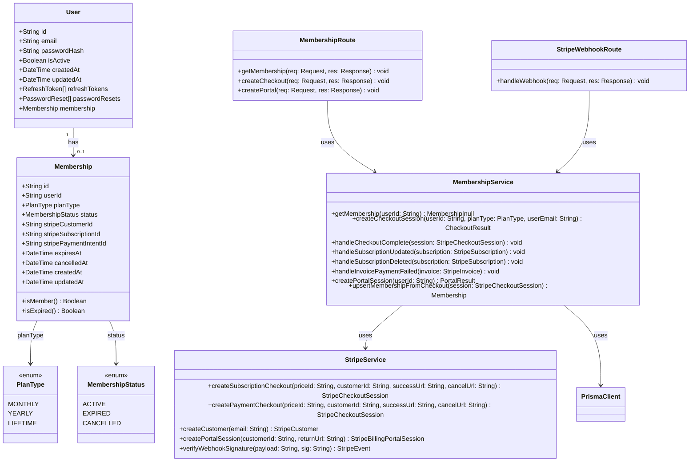
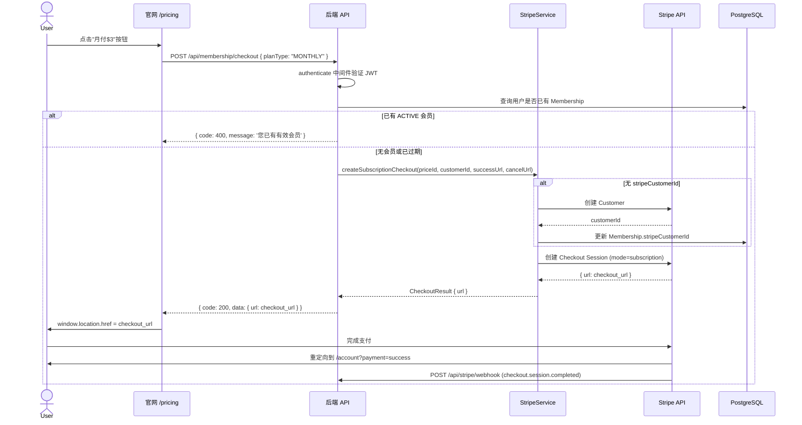
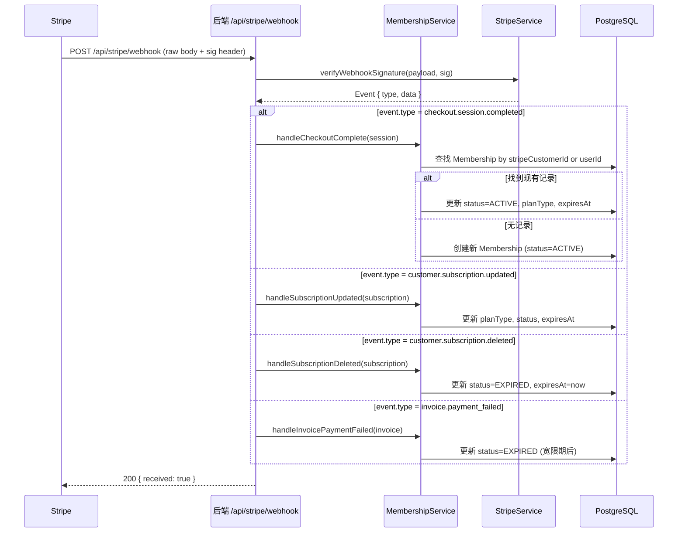
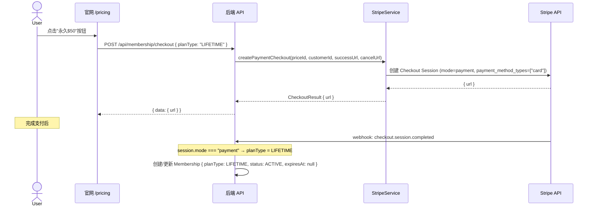
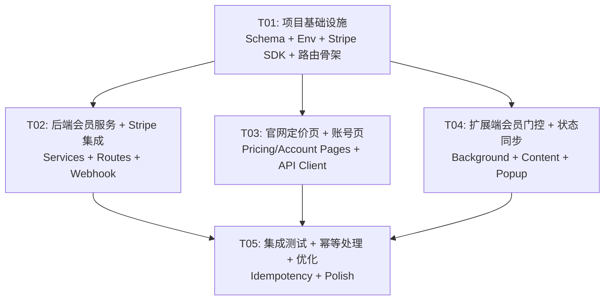

# ExportAI Stripe 会员系统 — 系统架构设计 + 任务分解

> 架构师：高见远（Bob）  
> 日期：2025-05  
> 版本：v1.0

---

## 目录

- [Part A: 系统设计](#part-a-系统设计)
  - [1. 实现方案](#1-实现方案)
  - [2. 文件列表](#2-文件列表)
  - [3. 数据结构和接口](#3-数据结构和接口)
  - [4. 程序调用流程](#4-程序调用流程)
  - [5. 待明确事项](#5-待明确事项)
- [Part B: 任务分解](#part-b-任务分解)
  - [6. 依赖包列表](#6-依赖包列表)
  - [7. 任务列表](#7-任务列表)
  - [8. 共享知识](#8-共享知识)
  - [9. 任务依赖图](#9-任务依赖图)

---

## Part A: 系统设计

### 1. 实现方案

#### 1.1 核心技术挑战

| 挑战 | 分析 | 方案 |
|------|------|------|
| **Stripe 双模式支付** | 月付/年付走 Checkout Session（subscription），永久$50走 Checkout Session（payment） | 统一使用 `stripe.checkout.sessions.create()`，通过 `mode` 参数区分：订阅用 `subscription`，一次性用 `payment` |
| **Webhook 可靠性** | 网络不可靠，需防重复处理 | 幂等键 = event.id，用 Prisma 事务保证 Membership 状态一致性 |
| **扩展端会员门控** | 扩展是纯 JS，无框架，需轻量方案 | background.js 维护会员状态缓存，content.js 通过消息获取状态，免费用户在 FAB 上显示🔒+弹窗 |
| **会员状态同步** | 扩展端无法接收推送，需轮询 | 启动时检查 + 30分钟轮询 + 支付成功后通过 URL 参数触发即时刷新 |
| **Token 存储不统一** | Web 用 localStorage，扩展用 chrome.storage.local | 遵循现有模式，各自存储，不改动现有 Token 管理架构 |

#### 1.2 框架选型

| 领域 | 选型 | 理由 |
|------|------|------|
| **后端 Stripe 集成** | `stripe` npm 官方 SDK | 官方维护，类型完备，Checkout/Webhook 支持完善 |
| **后端 Webhook 签名验证** | `stripe.webhooks.constructEvent()` | 内置于 stripe SDK，使用 `stripe-signature` header 验证 |
| **后端环境变量** | 扩展现有 `env.ts` (Zod) | 新增 `STRIPE_SECRET_KEY`、`STRIPE_WEBHOOK_SECRET`、`STRIPE_PRICE_MONTHLY`、`STRIPE_PRICE_YEARLY`、`STRIPE_PRICE_LIFETIME` |
| **前端定价页** | Next.js 14 App Router + Tailwind | 已有技术栈，三列卡片组件纯手写，无需额外 UI 库 |
| **前端账号页** | Next.js 14 App Router | 新增 `/account` 路由，复用 `lib/api.ts` 的 `apiRequest` |
| **扩展端** | 原生 JS | 维持现有技术栈不变，新增会员状态管理逻辑 |

#### 1.3 架构模式

- **后端**：延续现有分层模式 `routes → services → prisma`
- **前端**：Next.js App Router 页面组件，复用 `lib/api.ts` 通信
- **扩展**：消息驱动模式，background.js 作为状态中心

#### 1.4 Stripe 集成方式

```
用户选择方案 → 后端创建 Checkout Session → 重定向到 Stripe 托管页面
→ 支付完成 → Stripe 重定向回官网 → 同时 Stripe 发送 Webhook
→ 后端 Webhook 处理 → 更新 Membership 状态 → 扩展轮询获取新状态
```

**关键决策**：
- 使用 **Stripe Checkout**（而非嵌入式支付），因为实现简单、PCI 合规零负担
- Webhook 处理 `checkout.session.completed`、`customer.subscription.updated`、`customer.subscription.deleted`、`invoice.payment_succeeded`、`invoice.payment_failed`
- 永久方案使用 `mode: 'payment'`，订阅方案使用 `mode: 'subscription'`
- `success_url` 和 `cancel_url` 指向官网 `/account?payment=success` 和 `/pricing`

#### 1.5 扩展端会员门控方案

```
用户点击 FAB/自动导出触发
  → content.js 检查会员状态（从 background 获取）
  → 非会员：显示锁定弹窗（覆盖层），含"升级"按钮跳转官网 /pricing
  → 会员：正常执行导出
```

**会员状态缓存**：
- `chrome.storage.local` 存储 `exportai_membership`：`{ isMember: boolean, planType: string|null, expiresAt: string|null, checkedAt: string }`
- background.js 维护缓存，content.js/popup.js 通过消息获取

---

### 2. 文件列表

#### 2.1 后端 server/ — 新建文件

| 文件路径 | 说明 |
|----------|------|
| `server/src/routes/membership.ts` | 会员路由：GET /membership, POST /checkout, GET /portal |
| `server/src/routes/stripe.ts` | Stripe Webhook 路由：POST /webhook |
| `server/src/services/membership.service.ts` | 会员业务逻辑：查询状态、创建 checkout、处理 webhook 事件 |
| `server/src/services/stripe.service.ts` | Stripe API 封装：创建 checkout session、创建 portal session、获取订阅信息 |

#### 2.2 后端 server/ — 修改文件

| 文件路径 | 改动内容 |
|----------|----------|
| `server/prisma/schema.prisma` | 新增 Membership 模型、PlanType 枚举、Status 枚举；User 模型添加 membership 关联 |
| `server/src/config/env.ts` | 新增 STRIPE_SECRET_KEY、STRIPE_WEBHOOK_SECRET、STRIPE_PRICE_MONTHLY/YEARLY/LIFETIME 环境变量 |
| `server/src/middleware/validate.ts` | 新增 schemaCheckout (planType Zod 枚举) |
| `server/src/index.ts` | 注册 membership 和 stripe 路由；webhook 路由需在 express.json() 之前挂载（原始 body） |
| `server/src/services/auth.service.ts` | getMe 返回值增加 membership 信息 |
| `.env` / `.env.example` | 新增 Stripe 相关环境变量 |

#### 2.3 官网 web/ — 新建文件

| 文件路径 | 说明 |
|----------|------|
| `web/src/app/pricing/page.tsx` | 定价页面（三列卡片 + FAQ） |
| `web/src/app/account/page.tsx` | 账号页面（会员信息区 + 用户信息） |
| `web/src/components/PricingCard.tsx` | 定价卡片组件 |
| `web/src/components/MembershipStatus.tsx` | 会员状态显示组件（用于账号页） |

#### 2.4 官网 web/ — 修改文件

| 文件路径 | 改动内容 |
|----------|----------|
| `web/src/lib/api.ts` | 新增 `getMembership()`、`createCheckout(planType)`、`createPortalSession()` 函数 |
| `web/src/components/Navbar.tsx` | 导航栏添加"定价"链接，登录用户显示"账号"入口 |
| `web/src/app/page.tsx` | 首页添加"查看定价"CTA 链接 |

#### 2.5 扩展端 — 修改文件

| 文件路径 | 改动内容 |
|----------|----------|
| `background/background.js` | 新增会员状态缓存管理；新增 CHECK_MEMBERSHIP、MEMBERSHIP_CHECK 消息处理；启动时+30分钟轮询 |
| `content/content.js` | FAB 按钮增加🔒图标；点击时检查会员状态，非会员显示锁定弹窗；自动导出触发前检查会员 |
| `popup/popup.js` | 新增会员状态显示；升级按钮跳转 /pricing |
| `popup/popup.html` | 新增会员状态区域 HTML 结构 |
| `popup/popup.css` | 新增会员状态相关样式 |

#### 2.6 配置文件

| 文件路径 | 改动内容 |
|----------|----------|
| `docker-compose.yml` | server 环境变量新增 Stripe 相关配置 |
| `.env` | 新增 Stripe 环境变量 |

---

### 3. 数据结构和接口

#### 3.1 Prisma Schema 完整定义

```prisma
// 新增枚举
enum PlanType {
  MONTHLY
  YEARLY
  LIFETIME
}

enum MembershipStatus {
  ACTIVE
  EXPIRED
  CANCELLED
}

// 新增模型
model Membership {
  id                    String           @id @default(uuid()) @db.Uuid
  userId                String           @unique @map("user_id") @db.Uuid
  planType              PlanType         @map("plan_type")
  status                MembershipStatus @default(ACTIVE)
  stripeCustomerId      String?          @map("stripe_customer_id") @db.VarChar(255)
  stripeSubscriptionId  String?          @map("stripe_subscription_id") @db.VarChar(255)
  stripePaymentIntentId String?          @map("stripe_payment_intent_id") @db.VarChar(255)
  expiresAt             DateTime?        @map("expires_at") @db.Timestamp
  cancelledAt           DateTime?        @map("cancelled_at") @db.Timestamp
  createdAt             DateTime         @default(now()) @map("created_at") @db.Timestamp
  updatedAt             DateTime         @updatedAt @map("updated_at") @db.Timestamp

  user User @relation(fields: [userId], references: [id], onDelete: Cascade)

  @@index([stripeCustomerId])
  @@index([stripeSubscriptionId])
  @@map("memberships")
}

// User 模型新增关联（在现有 User 模型中添加）
// membership Membership?
```

#### 3.2 类图



#### 3.3 API 请求/响应格式

**所有 API 响应遵循现有 `{ code, data, message }` 格式。**

##### GET /api/membership

获取当前用户会员状态。

```typescript
// Response
{
  code: 200,
  data: {
    id: string;
    planType: 'MONTHLY' | 'YEARLY' | 'LIFETIME' | null;
    status: 'ACTIVE' | 'EXPIRED' | 'CANCELLED' | null;
    expiresAt: string | null;       // ISO 8601
    cancelledAt: string | null;     // ISO 8601
    isMember: boolean;              // 便捷字段：status === ACTIVE
  } | null,  // 无订阅时 data 为 null
  message: 'ok'
}
```

##### POST /api/membership/checkout

创建 Stripe Checkout Session。

```typescript
// Request Body
{
  planType: 'MONTHLY' | 'YEARLY' | 'LIFETIME'
}

// Response
{
  code: 200,
  data: {
    url: string  // Stripe Checkout URL，前端重定向到此地址
  },
  message: 'ok'
}
```

##### POST /api/stripe/webhook

Stripe Webhook 端点（无需认证，需签名验证）。

```typescript
// Request: Stripe 原始事件（raw body）
// Content-Type: application/json
// Header: stripe-signature

// Response
{
  code: 200,
  data: { received: true },
  message: 'ok'
}
```

##### GET /api/membership/portal (P1)

创建 Stripe Customer Portal Session。

```typescript
// Response
{
  code: 200,
  data: {
    url: string  // Stripe Portal URL
  },
  message: 'ok'
}
```

##### GET /api/auth/me（修改）

返回值增加 membership 信息。

```typescript
{
  code: 200,
  data: {
    id: string;
    email: string;
    isActive: boolean;
    createdAt: string;
    membership: {
      planType: string | null;
      status: string | null;
      isMember: boolean;
      expiresAt: string | null;
    } | null;
  },
  message: 'ok'
}
```

#### 3.4 环境变量新增

```env
# Stripe
STRIPE_SECRET_KEY=sk_test_xxx
STRIPE_WEBHOOK_SECRET=whsec_xxx
STRIPE_PRICE_MONTHLY=price_xxx
STRIPE_PRICE_YEARLY=price_xxx
STRIPE_PRICE_LIFETIME=price_xxx
```

#### 3.5 扩展端消息协议新增

| 消息类型 | 方向 | 数据 | 说明 |
|----------|------|------|------|
| `CHECK_MEMBERSHIP` | popup/content → background | — | 查询会员状态 |
| `MEMBERSHIP_STATUS` | background → popup/content | `{ isMember, planType, expiresAt }` | 会员状态响应 |
| `MEMBERSHIP_UPDATED` | background → content(广播) | `{ isMember, planType }` | 会员状态变更通知 |
| `SHOW_UPGRADE_MODAL` | content(内部) | — | 显示升级弹窗 |

#### 3.6 扩展端会员缓存结构

```javascript
// chrome.storage.local 中的会员缓存
{
  "exportai_membership": {
    isMember: boolean,
    planType: "MONTHLY" | "YEARLY" | "LIFETIME" | null,
    expiresAt: "2025-06-20T00:00:00.000Z" | null,
    checkedAt: "2025-05-20T10:30:00.000Z"  // 上次检查时间
  }
}
```

---

### 4. 程序调用流程

#### 4.1 支付流程（用户从官网发起）



#### 4.2 Webhook 处理流程



#### 4.3 扩展端会员检查流程

```mermaid
sequenceDiagram
    actor User
    participant Content as content.js
    participant BG as background.js
    participant API as 后端 API
    participant Storage as chrome.storage.local

    Note over BG: 扩展启动 / 30分钟定时器触发
    BG->>Storage: 读取 exportai_access_token
    alt 无 Token
        BG->>Storage: 写入 { isMember: false }
    else 有 Token
        BG->>API: GET /api/membership (Bearer token)
        API-->>BG: { data: { isMember, planType, expiresAt } }
        BG->>Storage: 更新 exportai_membership 缓存
        BG->>Content: 广播 MEMBERSHIP_UPDATED
    end

    Note over User: 用户点击 FAB
    User->>Content: 点击浮动按钮
    Content->>BG: CHECK_MEMBERSHIP
    BG->>Storage: 读取 exportai_membership
    Storage-->>BG: { isMember, ... }
    BG-->>Content: { isMember: true/false, planType, expiresAt }
    
    alt isMember = true
        Content->>Content: 正常展示 FAB 面板
    else isMember = false
        Content->>Content: 显示🔒+升级弹窗
        User->>Content: 点击"升级"
        Content->>Content: chrome.tabs.create({ url: WEB_URL + '/pricing' })
    end

    Note over User: 自动导出触发
    Content->>Content: MutationObserver 检测变化
    Content->>BG: CHECK_MEMBERSHIP
    BG-->>Content: { isMember: false }
    Content->>Content: 跳过自动导出（静默）
end
```

#### 4.4 永久方案支付流程



---

### 5. 待明确事项

| # | 事项 | 假设/建议 |
|---|------|-----------|
| 1 | Stripe 产品和价格 ID | 需在 Stripe Dashboard 创建，Price ID 配置到环境变量 |
| 2 | 月付/年付过期处理 | Webhook 收到 `customer.subscription.deleted` 时标记 EXPIRED；每天定时任务检查 expiresAt（可选，P1） |
| 3 | 已有会员再次购买 | 如果用户已有 ACTIVE 会员再购买其他方案，需要 Stripe Proration（P1），当前版本拒绝重复购买 |
| 4 | 扩展 API_BASE 硬编码 localhost | 目前扩展 `API_BASE = 'http://localhost:4000'`，生产环境需更新，但此问题不在本次 PRD 范围内 |
| 5 | Webhook 端点需要原始 body | Stripe 签名验证需要 raw body，需在 `express.json()` 之前挂载 webhook 路由或使用 `express.raw()` 中间件 |
| 6 | 免费/基础导出是否受限 | PRD 明确只有 FAB 和自动导出需会员，手动从 popup 导出仍免费 |
| 7 | Stripe Currency | 假设使用 USD（与PRD中$符号一致） |
| 8 | 永久方案的 stripePaymentIntentId | 从 checkout.session.completed 的 `session.payment_intent` 获取 |

---

## Part B: 任务分解

### 6. 依赖包列表

#### 后端 server/

```
- stripe@^17.0.0: Stripe 官方 Node.js SDK，用于创建 Checkout Session、Webhook 签名验证、Customer Portal
```

#### 官网 web/

```
- 无新增依赖（使用现有 Next.js + Tailwind 实现）
```

#### 扩展端

```
- 无新增依赖（使用现有 chrome API + 原生 JS）
```

---

### 7. 任务列表

#### T01: 项目基础设施（后端 Prisma Schema + 环境变量 + Stripe SDK 安装 + 路由骨架）

- **源文件**:
  - `server/prisma/schema.prisma` — 新增 Membership 模型、PlanType/MembershipStatus 枚举、User 关联
  - `server/src/config/env.ts` — 新增 5 个 Stripe 环境变量验证
  - `server/src/index.ts` — 注册 membership 路由、stripe webhook 路由；webhook 路由需在 `express.json()` 之前用 `express.raw({ type: 'application/json' })` 处理
  - `server/src/middleware/validate.ts` — 新增 schemaCheckout
  - `server/package.json` — 添加 `stripe` 依赖
  - `.env.example` — 新增 Stripe 相关变量示例
  - `docker-compose.yml` — server 环境变量新增 Stripe 配置
- **依赖**: 无
- **优先级**: P0
- **改动说明**: 
  1. 安装 `stripe` npm 包
  2. Prisma schema 新增 Membership 模型及枚举，User 添加 `membership Membership?` 关联
  3. env.ts 新增 `STRIPE_SECRET_KEY`、`STRIPE_WEBHOOK_SECRET`、`STRIPE_PRICE_MONTHLY`、`STRIPE_PRICE_YEARLY`、`STRIPE_PRICE_LIFETIME`
  4. index.ts 挂载新路由，webhook 路由使用 raw body parser
  5. validate.ts 新增 `schemaCheckout = z.object({ planType: z.enum(['MONTHLY', 'YEARLY', 'LIFETIME']) })`
  6. 运行 `npx prisma migrate dev` 创建数据库迁移

#### T02: 后端会员服务 + Stripe 集成（核心业务逻辑）

- **源文件**:
  - `server/src/services/stripe.service.ts` — Stripe API 封装（创建 checkout session、创建 customer、创建 portal session、验证 webhook 签名）
  - `server/src/services/membership.service.ts` — 会员业务逻辑（查询状态、创建 checkout、处理 webhook 事件、创建 portal session）
  - `server/src/routes/membership.ts` — 会员路由（GET /membership, POST /checkout, GET /portal）
  - `server/src/routes/stripe.ts` — Webhook 路由（POST /webhook，签名验证+事件分发）
  - `server/src/services/auth.service.ts` — getMe 方法返回值增加 membership 信息
- **依赖**: T01
- **优先级**: P0
- **改动说明**:
  1. **stripe.service.ts**: 
     - `createSubscriptionCheckout()`: mode=subscription, 创建订阅 checkout
     - `createPaymentCheckout()`: mode=payment, 创建一次性支付 checkout（永久方案）
     - `createCustomer()`: 创建 Stripe Customer
     - `createPortalSession()`: 创建 Customer Portal Session (P1)
     - `verifyWebhookSignature()`: 验证 webhook 签名
  2. **membership.service.ts**:
     - `getMembership()`: 查询用户会员状态，返回 `isMember` 便捷字段
     - `createCheckoutSession()`: 根据 planType 调用对应 Stripe 方法，处理已有/无 stripeCustomer 场景
     - `handleCheckoutComplete()`: 处理 checkout.session.completed 事件，区分 mode=subscription 和 mode=payment
     - `handleSubscriptionUpdated()`: 处理订阅变更
     - `handleSubscriptionDeleted()`: 处理订阅取消/过期
     - `handleInvoicePaymentFailed()`: 处理支付失败
  3. **membership.ts 路由**: 3 个端点，均需 authenticate 中间件
  4. **stripe.ts 路由**: 1 个端点，无需认证，需 raw body + 签名验证
  5. **auth.service.ts**: getMe 的 Prisma 查询添加 `include: { membership: true }`，返回 membership 信息

#### T03: 官网定价页 + 账号页 + API 客户端

- **源文件**:
  - `web/src/lib/api.ts` — 新增 getMembership()、createCheckout()、createPortalSession() 函数
  - `web/src/app/pricing/page.tsx` — 定价页面（三列卡片，暗色主题，年付推荐高亮，底部 FAQ）
  - `web/src/app/account/page.tsx` — 账号页面（未登录跳转、会员信息区、支付成功回调处理）
  - `web/src/components/PricingCard.tsx` — 定价卡片组件（方案名、价格、特性列表、CTA 按钮）
  - `web/src/components/MembershipStatus.tsx` — 会员状态组件（未订阅→升级横幅、已订阅→状态+管理、永久→星标、已过期→重新订阅）
  - `web/src/components/Navbar.tsx` — 添加"定价"链接、登录用户显示"账号"入口
  - `web/src/app/page.tsx` — 首页 CTA 区域添加"查看定价"链接
- **依赖**: T01（需要后端 API 可用）
- **优先级**: P0
- **改动说明**:
  1. **api.ts**: 新增 3 个 API 调用函数，复用现有 apiRequest + Token 自动刷新
  2. **pricing/page.tsx**: Server Component + Client Component 混合，三列卡片（月$3/年$20/永久$50），年付列高亮边框+推荐标签，点击 CTA 调用 createCheckout 后重定向
  3. **account/page.tsx**: Client Component，检查 URL 参数 `payment=success`，展示会员状态（复用 MembershipStatus 组件），管理按钮调用 createPortalSession
  4. **PricingCard.tsx**: 接收 planType/price/features/highlighted props，暗色主题样式与现有网站一致
  5. **MembershipStatus.tsx**: 4 种状态的 UI（未订阅/已订阅/永久/已过期），含管理/升级/重新订阅按钮
  6. **Navbar.tsx**: 桌面端和移动端导航均添加"定价"和"账号"链接

#### T04: 扩展端会员门控 + 状态同步

- **源文件**:
  - `background/background.js` — 新增会员状态缓存管理、定时轮询、CHECK_MEMBERSHIP 消息处理
  - `content/content.js` — FAB 增加🔒图标逻辑、非会员点击弹窗、自动导出门控
  - `popup/popup.js` — 会员状态显示、升级按钮
  - `popup/popup.html` — 会员状态区域 HTML
  - `popup/popup.css` — 会员相关样式
- **依赖**: T01（需要后端 API 可用）
- **优先级**: P0
- **改动说明**:
  1. **background.js**:
     - 新增 `MEMBERSHIP_STORAGE_KEY = 'exportai_membership'`
     - 新增 `checkMembershipStatus()`: 调用 `GET /api/membership`，更新 chrome.storage.local 缓存
     - 新增 `startMembershipPolling()`: 启动时检查 + `setInterval(30min)` 轮询
     - 新增消息处理：`CHECK_MEMBERSHIP` → 从缓存返回；`MEMBERSHIP_UPDATED` 广播
     - `onInstalled` 中启动会员轮询
  2. **content.js**:
     - `injectFloatingButton()`: FAB 按钮添加🔒SVG 图标（非会员可见）
     - FAB 点击事件：先发 `CHECK_MEMBERSHIP` 消息，非会员 → 显示升级弹窗（内嵌 overlay），会员 → 正常展开面板
     - 自动导出 MutationObserver 回调：增加会员检查，非会员静默跳过
     - 升级弹窗：CSS 样式 + HTML 覆盖层，"升级"按钮 `chrome.tabs.create({ url: WEB_URL + '/pricing' })`
  3. **popup/popup.js**:
     - `initAuthUI()`: 登录后查询会员状态并显示
     - 新增 `updateMembershipUI()`: 在设置页显示会员状态（会员类型+过期时间/永久标识）
     - 升级按钮：非会员显示"升级"按钮，跳转 `/pricing`
  4. **popup/popup.html**: 在 settingsAuthBar 下方新增会员状态区域
  5. **popup/popup.css**: 会员状态卡片、升级按钮样式

#### T05: 集成测试 + Webhook 幂等处理 + 支付回调页面优化

- **源文件**:
  - `server/src/services/membership.service.ts` — 完善幂等处理（基于 Stripe Event ID 去重）
  - `server/src/routes/stripe.ts` — 增加错误处理和日志
  - `web/src/app/account/page.tsx` — 优化支付成功回调体验（成功提示动画）
  - `background/background.js` — 支付后即时刷新逻辑（检测 URL 参数触发）
  - `content/content.js` — 完善锁定弹窗 UI 细节
- **依赖**: T02, T03, T04
- **优先级**: P1
- **改动说明**:
  1. **membership.service.ts**: 
     - 新增 `processedEventIds` Set（内存级别，足够应对 Stripe 重试窗口 72h）
     - Webhook 处理前检查 event.id 是否已处理
     - 处理成功后记录 event.id
  2. **stripe.ts**: 增加异常捕获和详细日志
  3. **account/page.tsx**: 支付成功时显示绿色成功横幅 + 自动刷新会员状态
  4. **background.js**: 扩展安装时/Tab 更新时检查 URL 是否含 `payment=success`，触发即时会员状态刷新
  5. **content.js**: 锁定弹窗微调（渐入动画、点击外部关闭等）

---

### 8. 共享知识

#### 8.1 通用约定

```
- 所有 API 响应格式: { code: number, data: T | null, message: string }
- 认证方式: Bearer Token (JWT)，通过 Authorization header 传递
- 所有日期存储为 ISO 8601 UTC 字符串
- 错误处理: 使用 AppError 类，统一通过 errorHandler 中间件返回
- 验证: 使用 Zod schema + validate 中间件
```

#### 8.2 Stripe 相关约定

```
- 月付方案: mode=subscription, priceId=STRIPE_PRICE_MONTHLY
- 年付方案: mode=subscription, priceId=STRIPE_PRICE_YEARLY  
- 永久方案: mode=payment, priceId=STRIPE_PRICE_LIFETIME
- Currency: USD
- Checkout success_url: {WEB_URL}/account?payment=success&session_id={CHECKOUT_SESSION_ID}
- Checkout cancel_url: {WEB_URL}/pricing
- Webhook 签名验证: 必须使用 raw body，不能经过 JSON.parse
- 同一用户只创建一个 Stripe Customer，通过 stripeCustomerId 关联
```

#### 8.3 扩展端约定

```
- API 代理: 所有后端请求通过 background.js 的 API_REQUEST 消息机制
- Token 存储: chrome.storage.local (exportai_access_token, exportai_refresh_token)
- 会员缓存: chrome.storage.local (exportai_membership)
- 消息协议: chrome.runtime.sendMessage，异步 sendResponse
- 定时器: 30分钟轮询使用 chrome.alarms API（service worker 友好）
- 外部链接: chrome.tabs.create() 在新标签页打开
```

#### 8.4 前端约定

```
- 暗色主题: 背景色 #0a0a0f，卡片 #12121a，边框 #1e1e2e
- 主色调: #6366f1 (primary) / #8b5cf6 (secondary)
- API 客户端: 复用 lib/api.ts 的 apiRequest，自动 Token 刷新
- Token 存储: localStorage (exportai_access_token, exportai_refresh_token, exportai_user_info)
```

#### 8.5 数据库约定

```
- ID 生成: @default(uuid()) @db.Uuid
- 字段映射: snake_case in DB → camelCase in Prisma (via @map)
- 表名映射: plural in DB (via @@map)
- 时间字段: @db.Timestamp，自动 createdAt + updatedAt
- 软删除: 不使用，依赖级联删除 (onDelete: Cascade)
```

---

### 9. 任务依赖图



**关键路径**: T01 → T02 → T05  
**可并行**: T02、T03、T04 在 T01 完成后可并行开发
